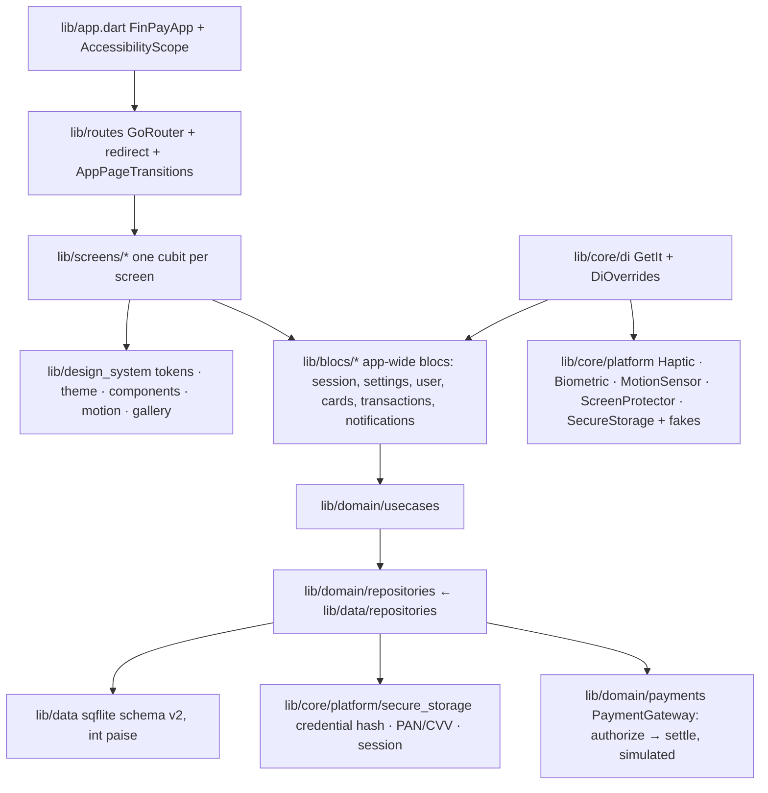

# FinPay

A demo fintech app for Android and iOS, built with Flutter: a dark NeoPOP
interface with physics-based motion, an exact-paise ledger in sqflite,
salted credential hashing, and a payment flow that stays idempotent under
abuse. Everything runs on the device: payments, OTP, biometrics, contacts
and the "bank" are simulated, and the app never touches the network.

FinPay is a portfolio project. It shows what a CRED-grade UI looks like
when it is built test-first: 1,500+ tests, 144 golden baselines, a stress
suite that pushes 100,000 ledger rows and 1,000-tap storms through the real
screens, and a security review after every feature.

## Features

**Onboarding and sign-in**
- Welcome screen with a serif wordmark reveal and CTAs that rise on a
  spring; three onboarding pages with code-drawn three-layer parallax
  illustrations and a morphing page indicator.
- NeoPOP login and sign-up forms with inline validation, shake + haptic on
  errors, a spinner that morphs out of the button label, and a 30-second
  lockout after five wrong passwords.
- OTP entry with auto-advance, paste, backspace, a red flash on a wrong
  code and a resend countdown ring; biometric enrolment with a finite pulse
  and a drawn check; a password-reset screen that never reveals whether an
  address exists.

**Home**
- A pinned collapsing header: the balance counts up on a serif odometer,
  shrinks and docks beside the eye icon as you scroll; the eye masks the
  balance (`₹••••••`) and the choice persists.
- Staggered quick actions, the newest card as a Hero into its details, an
  offers carousel whose badges tilt with the scroll, five recent
  transactions with skeleton / empty / error + retry states, and a custom
  NeoPOP pull-to-refresh.

**Cards**
- A pile that fans out on a spring into a perspective carousel; tap to flip
  (the back is drawn un-mirrored), a five-second CVV reveal read on demand
  from secure storage, sensor-driven tilt with a moving sheen (pointer
  fallback where there is no gyroscope).
- Add card with a live preview, BIN detection (Visa / Mastercard / RuPay
  cross-fade), Luhn, expiry and CVV validation; card details with
  copy-last-4, freeze and a remove confirmation sheet.

**Payments**
- Searchable contact picker (recently paid first), an odometer amount with
  per-digit roll driven by a NeoPOP keypad, quick-amount chips and a note.
- A review sheet that rises on a spring with a swipe-to-pay slider (haptic
  ticks at 25 / 50 / 75 %, snap-back, locked while processing), a
  processing ring, then success (drawn check, confetti, odometer, receipt,
  copy-to-share) or failure (drawn cross + shake, Retry / Edit amount /
  Edit payment).

**Insights and activity**
- Statistics with a Week / Month / Year switcher, odometer Spent / Received
  cards, bars that grow, a daily line that draws on, a category donut that
  sweeps, and top merchants.
- Transactions paged 50 at a time with sticky day headers, debounced
  search, filter chips pushed into SQL, swipe actions (Details / Delete with
  Undo) and a masked detail sheet.
- Notifications with staggered entry, swipe-to-dismiss + undo, a finite
  unread pulse and mark-all-read.
- Profile with a parallax avatar header, NeoPOP toggles (haptics, reduce
  motion, hide balance), an About sheet and an animated logout
  confirmation.

**App-wide**
- One transition vocabulary per route (shared-axis for flows, fade-through
  for root switches, a rising sheet for the add-card form), a native splash
  that hands over to the first Flutter frame on the same background, and an
  original app icon rendered from Dart.

## Screenshots and recordings

Static screenshots are copies of the golden baselines in
[`docs/images/`](docs/images/README.md); the gallery below is the design
system at 1.0× text scale.


Motion does not survive a screenshot. The table lists the recordings to
capture on a phone (names and instructions in
[`docs/images/README.md`](docs/images/README.md)); each cell becomes a GIF
once recorded.

| Recording | Flow |
|---|---|
| `onboarding.gif` | Welcome wordmark, spring CTAs, parallax onboarding |
| `login.gif` | Validation shake, spinner morph, fade-through to home |
| `home_header.gif` | Balance odometer, collapsing header, hide balance |
| `card_stack.gif` | Fan-out, carousel, tilt + sheen, flip, CVV reveal |
| `add_card.gif` | Live preview with the BIN cross-fade, validation |
| `swipe_to_pay.gif` | Keypad, review sheet, swipe-to-pay, success |
| `payment_failure.gif` | Decline, shake, retry, "already paid" on timeout |
| `statistics.gif` | Growing bars, drawing line, sweeping donut, switcher |
| `transactions.gif` | Sticky headers, search, filters, swipe + undo |
| `profile.gif` | Parallax header, toggles, logout sheet |

## Design system and motion

`lib/design_system/` is the only place with raw colours, durations and
curves; a test scans every other file under `lib/` to keep it that way.

- **Tokens** (`FpColors`, `FpSpacing` 4/8/12/16/24/32/48, `FpRadii`,
  `FpDepth`, `FpTypography` Manrope + Instrument Serif, `FpMotion`
  150 / 250 / 400 / 450 ms with Material-3 emphasized curves, `FpSprings`
  press / sheet / slider) are exposed as a `ThemeExtension` and read with
  `context.fp`. Text colours pass WCAG AA on their surfaces (tested).
- **NeoPOP** rendering uses CRED's open-source `neopop` package as the
  painter for buttons and surfaces, wrapped in `FpButton` / `FpSurface` so
  screens never import it; the wrappers add semantics, 48 dp targets,
  reduce-motion, haptics and a submit guard.
- **Components**: `FpButton`, `FpSurface`, `FpTextField`, `FpChip`,
  `FpToggle`, `FpSegmentedControl`, `FpPageIndicator`, `FpAmountText`
  (odometer), `FpBottomSheet` (spring, drag to dismiss), `FpToast`,
  `FpSkeleton` (one shared shimmer ticker), `FpEmptyState` / `FpErrorState`,
  `FpOtpField`, `FpCountdownRing`, `FpBottomNav`, `FpRefreshIndicator`,
  `FpCollapsingHeader`, `FpSwipeToPay`, `FpProcessingRing`,
  `FpSwipeActionRow`.
- **Motion primitives**: `FpPressable`, `FpSubmitGuard`, `FpEntrance` /
  `FpStaggeredEntrance`, `FpParallax`, `FpPageTransitions` (shared-axis and
  fade-through on `package:animations`), `FpHero`, `FpShake`, `FpPulse`
  (finite), `FpConfetti` (a `CustomPainter`, no package), `FpDrawnCheck`,
  `FpFlipCard`, `FpTiltCard`.
- **Rules**: springs for anything pressed or dragged, no linear curves,
  press feedback within one frame, delight effects finite and reserved for
  key moments, nothing blocks input behind decoration. Every animation
  degrades to a fade or a cut when the system or the in-app "Reduce motion"
  setting asks for it, and layouts are tested at 1.3× text scale (the app
  clamps larger system scales to 1.3×).
- A debug-only widget gallery at `/gallery` (profile → "Widget gallery")
  shows every component in every state; it is the source of the
  design-system goldens. Full reference: [`docs/DESIGN_SYSTEM.md`](docs/DESIGN_SYSTEM.md).

## Tech stack

| Layer | Choice |
|---|---|
| Framework | Flutter 3.47.9, Dart 3.13.7 (pinned as a floor in `pubspec.yaml`) |
| State | `flutter_bloc` 9 (sealed `Equatable` states, one-off effects on a separate stream) |
| Routing | `go_router` 18 with a pure redirect, typed route extras, `StatefulShellRoute` tabs |
| Storage | `sqflite` (schema v2, money as `int` paise), `flutter_secure_storage` (credential hash, PAN/CVV, session), `shared_preferences` (settings) |
| DI | `get_it` with override points for every platform interface and repository |
| Charts | `fl_chart` 1.3 |
| NeoPOP | `neopop` 1.0.2 (painter only) |
| Motion | `animations` 3 (shared-axis / fade-through), Flutter physics springs |
| Platform | `local_auth` (biometrics), `sensors_plus` (tilt), `vibration` (haptics), a `MethodChannel` for `FLAG_SECURE` |
| Money / time | `intl` (`en_IN`), `clock` (injectable) |
| Brand | `flutter_launcher_icons`, `flutter_native_splash` (assets rendered by `tool/render_brand_assets.dart`) |
| Tests | `flutter_test`, `bloc_test`, `mocktail`, `fake_async`, `sqflite_common_ffi`, `integration_test`, `flutter_driver`, `very_good_analysis` |

## Architecture



Clean Architecture with BLoC: screens render immutable states and send
events; use cases and repositories own the rules; the data layer owns
SQL and secure storage. Every platform capability sits behind an interface
with a fake, so widget tests boot the real router and DI with
`sqflite_common_ffi` in memory.

## How to run

```bash
# Flutter 3.47.9 (stable). Pin it, e.g. with fvm, or use a local SDK:
export PATH=$HOME/flutter_sdks/3.47.9/flutter/bin:$PATH
flutter pub get
flutter run            # pick a device; -d <id> to choose
```

Demo account (seeded on first launch, public by design):

| | |
|---|---|
| Email | `user@finpay.com` |
| Password | `FinPay123` |

- Sign-up is simulated: any name, email, 10-digit Indian mobile number and an
  8+ character password; the verification code is the **last six digits of
  the mobile number**. Sign-up re-keys the single on-device account.
- Payments are simulated by `SimulatedPaymentGateway`: any normal contact
  succeeds; **"Test Decline"** is declined by the bank; **"Test Timeout"**
  times out on the first confirmation, and Retry reports "already paid"
  (the ledger write was idempotent).
- Biometrics, the password-reset email and the contact list are local
  fakes. The balance, cards, transactions and notifications live in sqflite
  on the device and survive restarts.

Release build:

```bash
flutter build apk --release --obfuscate --split-debug-info=build/symbols
```

## Tests

```bash
dart format --output=none --set-exit-if-changed .
flutter analyze                                   # very_good_analysis, zero issues
flutter test --concurrency=4                      # unit + widget + golden
flutter test --update-goldens test/golden         # only for an intended visual change
flutter test --tags stress --dart-define=FINPAY_STRESS=true --concurrency=1 test/stress
flutter test --coverage --concurrency=4 && dart run tool/coverage_summary.dart

# On an attached device (one at a time):
flutter test integration_test/app_flows_test.dart -d <device id>
flutter drive --driver=test_driver/integration_test.dart \
    --target=integration_test/app_flows_test.dart -d <device id>
flutter drive --driver=test_driver/integration_test.dart \
    --target=integration_test/perf_test.dart --profile -d <device id>
# → build/perf/<section>.timeline_summary.json
```

| Kind | Count | Where |
|---|---:|---|
| Unit | 969 | `test/unit/**` (blocs, use cases, repositories, validators, money, migration, cubits, maths), `test/design_system/tokens`, motion logic |
| Widget | 481 | `test/widget/**` (every screen through the real router + DI with platform fakes), `test/design_system/**` components and motion |
| Golden | 78 test cases, 144 PNG baselines | `test/golden/**` at 1.0× and 1.3× text scale (24 design-system + 120 screen baselines) |
| Stress | 41 | `test/stress/**`, tag `stress`, gated by `FINPAY_STRESS` |
| Integration | 4 (3 flows + 1 profile trace) | `integration_test/**`; not run: no device attached |

`flutter test --concurrency=4` on the Wave 2 branch: **1,528 passed, 7 skipped** (the seven are the stress files' placeholders when the flag is off); `flutter analyze`: no issues; `dart format`: clean.

Golden baselines render the bundled fonts and tolerate ≤ 0.5 % differing
pixels. Stress tests are tagged `stress` and gated behind the
`FINPAY_STRESS` define, so the default run stays fast. Integration tests
boot the real DI and the real database on the device; the flows are
device-state independent (a restored session is logged out first).

**Coverage** (`flutter test --coverage`, lines, from `coverage/lcov.info`):

| Folder | Lines hit | Lines found | Coverage |
|---|---:|---:|---:|
| `lib (root)` | 36 | 41 | 87.8 % |
| `lib/blocs` | 397 | 441 | 90.0 % |
| `lib/core` | 538 | 609 | 88.3 % |
| `lib/data` | 394 | 397 | 99.2 % |
| `lib/design_system` | 2656 | 2720 | 97.6 % |
| `lib/domain` | 100 | 113 | 88.5 % |
| `lib/models` | 165 | 167 | 98.8 % |
| `lib/routes` | 126 | 129 | 97.7 % |
| `lib/screens` | 5347 | 5458 | 98.0 % |
| `lib/utils` | 48 | 48 | 100.0 % |
| **lib (total)** | 9807 | 10123 | 96.9 % |

## Performance

Host-side frame times from the stress suite (Linux, Dart JIT, software
rendering: build + layout + paint of one frame, no raster thread). They rank
screens and catch regressions; they are not phone numbers.

| Screen / scenario | Frames | Avg | p90 | p99 | > 16 ms |
|---|---:|---:|---:|---:|---:|
| Home: header collapse + expand (10 cycles) | 300 | 2.56 ms | 4.57 ms | 7.56 ms | 0 |
| Cards: 12-card fan-out + collapse (5 cycles) | 375 | 1.59 ms | 1.92 ms | 7.15 ms | 1 |
| Transfer: 300 keypad inputs | 300 | 3.98 ms | 9.66 ms | 19.84 ms | 3 |
| Statistics: year entrance (365 points) + 4 switches | 180 | 2.09 ms | 3.14 ms | 16.14 ms | 2 |
| Transactions: 2,000 rows, 20 pages scrolled | 360 | 2.12 ms | 3.95 ms | 10.62 ms | 3 |

Other stress results: 100,000 ledger rows seed in about 1 s and the first
page returns in 1–3 ms; 1,000 rapid taps on login, pay, add-card or
hide-balance produce exactly one action; 1,000 sequential payments keep the
balance exact with no leaked tickers or sensor listeners; a 50-card stack
under 60 Hz tilt averages ~1.2 ms per frame. The full log is in
[`docs/LOAD_TEST_REPORT.md`](docs/LOAD_TEST_REPORT.md).

Device numbers (build and raster averages, p90, p99 and missed frames per
screen) come from `integration_test/perf_test.dart` through
`flutter drive --profile`; **not run: no device** was attached during the
Wave 2 run. The commands above write them to `build/perf/`.

## Security highlights

- Credentials are a PBKDF2-HMAC-SHA256 hash (10,000 iterations, 16-byte
  salt, constant-time compare) in secure storage; the demo password never
  appears under `lib/` (a test checks).
- Card numbers and CVVs never enter app-wide state: the card bloc holds
  masks, the CVV is read on demand for a timed five-second reveal, and the
  clipboard only ever receives the last four digits or a masked VPA.
- `FLAG_SECURE` on balance, card, payment and credential screens (recents
  thumbnail blank, screenshots blocked), `filterTouchesWhenObscured` against
  tapjacking, `allowBackup="false"`, a single exported activity with no
  deep links, `/gallery` unreachable in release, logger silent in release.
- Payments are idempotent: one key per draft, a unique index in the
  ledger, one exclusive transaction; 1,000 taps or swipes create one row.
- Every input is bounded (amount, note, search, card fields; non-ASCII
  digits, bidi overrides, emoji and 100,000-character pastes are tested),
  every query is parameterised, and `' OR 1=1 --` returns nothing.
- Full history, severity and open items: [`docs/SECURITY_REVIEW.md`](docs/SECURITY_REVIEW.md).

## Simulated / demo data

Nothing in FinPay is real. Payments go through a simulated gateway, the OTP
is derived from the phone number, biometrics and the password-reset email
are faked, the contacts are a fixed list, and the money is a number in a
local database. The app makes no network requests and no real account,
card or bank is involved.

FinPay is inspired by CRED's NeoPOP design language; it is not affiliated with CRED.
