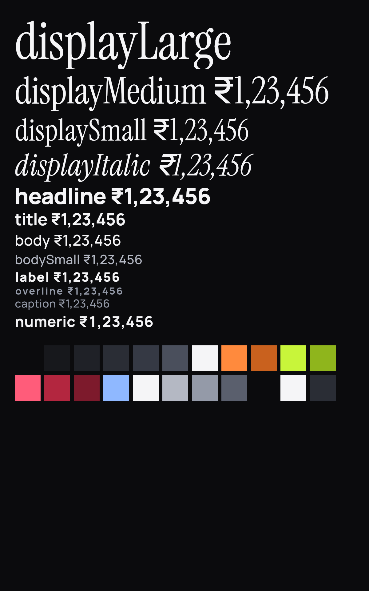
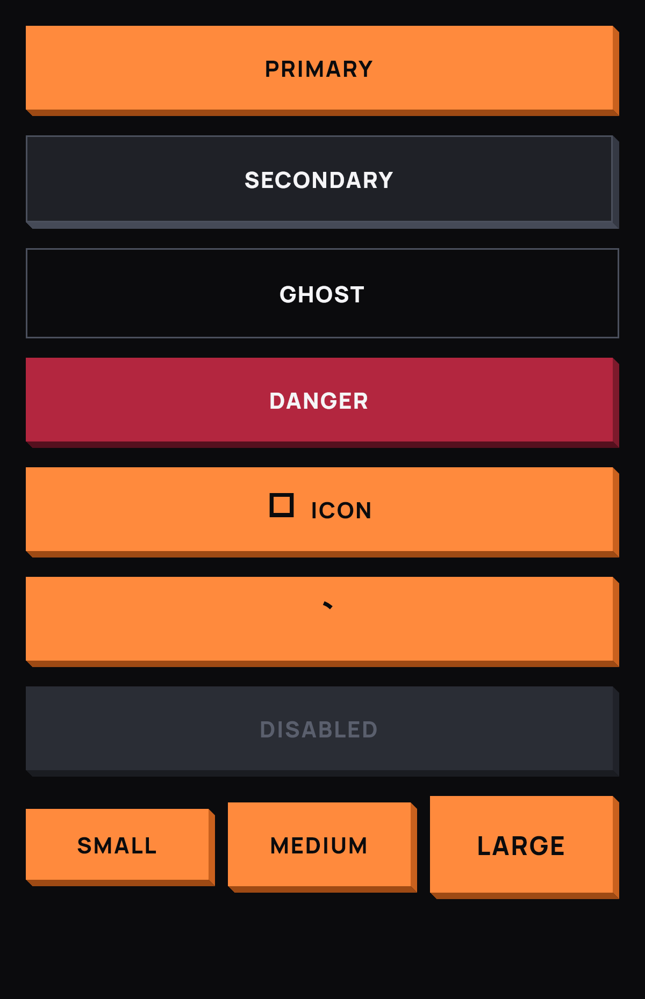

# FinPay design system (F2)

Everything lives under `lib/design_system/` and is exported by the barrel
`package:fin_pay/design_system/design_system.dart`. Public widgets are
prefixed `Fp`. Screens never import `package:neopop` directly: the package
sits behind `FpButton` and `FpSurface` (see D-003 and D-008).

Gallery screenshot: to be added by Wave 2 (the golden
`test/golden/design_system/goldens/gallery_1_0.png` is the current render).

```
lib/design_system/
  design_system.dart      barrel
  fp_haptics.dart         resolveHaptics() / playHaptic(): parameter → GetIt → skip
  tokens/                 fp_colors, fp_contrast, fp_spacing (+ FpRadii), fp_depth,
                          fp_typography, fp_motion (FpMotion, FpSprings)
  theme/                  fp_tokens (FpTokens ThemeExtension, context.fp), fp_theme (FpTheme.dark())
  components/             fp_button, fp_surface, fp_text_field, fp_chip, fp_toggle,
                          fp_bottom_sheet, fp_toast, fp_skeleton, fp_state_views,
                          fp_amount_text (+ FpOdometer), fp_segmented_control, fp_page_indicator,
                          fp_otp_field, fp_countdown_ring (F3),
                          fp_bottom_nav, fp_refresh_indicator, fp_collapsing_header (F4),
                          fp_swipe_to_pay (+ FpSwipeMath), fp_processing_ring (F5),
                          fp_swipe_action_row (+ FpSwipeActionMath) (F6)
  motion/                 fp_pressable, fp_submit_guard, fp_staggered_entrance (FpEntrance,
                          FpStaggeredEntrance, FpStagger), fp_parallax, fp_page_transitions,
                          fp_hero, fp_shake, fp_pulse, fp_confetti, fp_drawn_check (F3),
                          fp_flip_card, fp_tilt_card (F4)
  gallery/                gallery_screen (FpGallery.route = '/gallery', FpGalleryScreen)
```

## 1. Tokens

### Colours (`FpColors`, `context.fp.colors`)

| Token | Hex | Use |
|---|---|---|
| `background` | `#0B0B0D` | Page background |
| `surface` | `#17181C` | Cards, sheets (1.11:1 above background; the old theme was 1.02:1) |
| `surfaceRaised` | `#1F2127` | Inputs, chips, rows on a card |
| `surfaceHigh` | `#2A2D35` | Toasts, menus, selected segments (1.43:1 above background) |
| `border` / `borderStrong` | `#353944` / `#4A4F5C` | Hairline / focused borders |
| `popWhite` | `#F5F5F7` | Primary text, selected chip face |
| `accent` / `accentDeep` | `#FF8A3D` / `#C9611E` | Primary action face / edge |
| `success` / `successDeep` | `#C8F53A` / `#8FB51C` | Positive outcomes, toggle on |
| `alert` | `#FF5C7A` | Error text and icons (AA on every surface) |
| `alertFill` / `alertDeep` | `#B3263F` / `#7D1A2C` | Destructive button face (white text) / edge |
| `info` | `#8FB8FF` | Neutral toasts |
| `textPrimary` / `textSecondary` / `textTertiary` | `#F5F5F7` / `#B4B8C3` / `#949AA8` | Text tiers (all ≥ 4.5:1 on all four surfaces) |
| `textDisabled` | `#5A5F6D` | Disabled text (exempt from AA) |
| `onPop` / `onAlert` | `#0B0B0D` / `#F5F5F7` | Text on accent/success/white faces, on `alertFill` |
| `disabledFace` | `#2A2D35` | Disabled button face |
| `scrim` | `#0B0B0D` @ 70 % | Behind sheets |

`FpContrast.ratio()` implements WCAG 2.1; `test/design_system/tokens/fp_tokens_test.dart`
checks every text × surface pair (28 pairs) plus the four face pairs for ≥ 4.5:1
and the surface ramp for visible separation.

### Spacing, radii, depth

| Scale | Values |
|---|---|
| `FpSpacing` | xs 4, sm 8, md 12, lg 16, xl 24, xxl 32, xxxl 48; `minTapTarget` 48 |
| `FpRadii` | none 0, xs 2, sm 4, md 8, lg 12, pill 999 (NeoPOP stays sharp: components use 0) |
| `FpDepth` | none 0, chip 2, button 4, surface 6, sheet 8 (solid bottom/right edge faces) |
| `FpEdge` | right/bottom face colours per face: accent, success, alert, popWhite, surface, surfaceRaised, disabled |

### Typography (`FpTypography`, `context.fp.text`)

| Style | Family | Size / weight | Use |
|---|---|---|---|
| `displayLarge` | Instrument Serif | 56 | Hero balance |
| `displayMedium` | Instrument Serif | 40 | Amounts (default of `FpAmountText`) |
| `displaySmall` | Instrument Serif | 32 | Secondary amounts |
| `displayItalic` | Instrument Serif italic | 32 | Editorial accents |
| `headline` | Manrope | 24 / 800 | Screen titles |
| `title` | Manrope | 18 / 700 | Section titles, sheet titles |
| `body` | Manrope | 16 / 500 | Body, inputs |
| `bodySmall` | Manrope | 14 / 500 | Subtitles (textSecondary) |
| `label` | Manrope | 14 / 800, +0.8 tracking | Buttons, chips (uppercase) |
| `overline` | Manrope | 11 / 700, +1.2 tracking | Eyebrow labels, field labels |
| `caption` | Manrope | 12 / 500 | Helper text (textTertiary) |
| `numeric` | Manrope | 16 / 700, tabular | Row amounts |

Display styles carry `fontFamilyFallback: ['Manrope']` because Instrument Serif has
no rupee glyph (D-013). Amount styles use tabular figures.

### Motion (`FpMotion`, `FpSprings`)

| Token | Value | Use |
|---|---|---|
| `fast` | 150 ms | Press feedback, focus glow, small state changes |
| `standard` | 250 ms | Chips, toggles, indicators, odometer roll |
| `emphasized` | 400 ms | Entrances, sheets, toasts |
| `screen` | 450 ms | Page transitions (reverse 400 ms) |
| `emphasizedDecelerate` | cubic(0.05, 0.7, 0.1, 1) | Entering |
| `emphasizedAccelerate` | cubic(0.3, 0, 0.8, 0.15) | Leaving |
| `standardCurve` | cubic(0.2, 0, 0, 1) | In-place change |
| `standardDecelerate` | cubic(0, 0, 0, 1) | Small entrances |
| `FpSprings.press` | stiffness 500, ratio 0.75 | Button release |
| `FpSprings.sheet` | stiffness 280, ratio 0.9 | Sheet entrance and snap-back |
| `FpSprings.slider` | stiffness 650, ratio 0.85 | Toggle thumb, swipe-to-pay |

`FpMotion.of(context).reduce` reads `MediaQuery.disableAnimations`. Every animated
component checks it and falls back to a fade or to no motion (tested per component).

## 2. Theme

`FpTheme.dark()` returns a `ThemeData` (brightness dark, Manrope, `NoSplash`,
flat app bar, sheet/snackbar/progress/divider themes from the tokens) with the
`FpTokens` `ThemeExtension`. `context.fp` returns the tokens (`colors`, `text`,
`metrics`, `motion`), falling back to `FpTokens.dark` outside a theme.

## 3. Components

All components: `Semantics` labels/roles, ≥ 48 dp targets, reduce-motion path,
haptics through `HapticService` (constructor parameter, else GetIt, else none).

| Component | States / variants | Motion | Haptic |
|---|---|---|---|
| `FpButton` | primary, secondary, ghost, danger × small 48 / medium 56 / large 64; leading icon; `isLoading` (label morphs to spinner, presses blocked); `enabled`; `expand` | Depth edge collapses on press (60 ms), springs back (`press`); label ↔ spinner fade+scale | `medium` on press down |
| `FpSurface` | flat (border only), plunk (edge), raised (lighter face + edge); optional `onTap` → pressable | Plunk translate + 0.985 scale when tappable | `light` when tappable |
| `FpTextField` | idle, focused (accent border + glow), error (alert border, message, shake), disabled, obscured (+ eye toggle), prefix/suffix, `inputFormatters`, `maxLength` | Border/glow 150 ms; shake 400 ms on new error | `error` on new error |
| `FpChip` | idle, selected (pop-white face), with icon, disabled | Face colour 250 ms, 0.94 press scale | `selection` |
| `FpToggle` | off, on (success track), disabled | Thumb on `slider` spring | `light` |
| `FpSegmentedControl` | n ≥ 2 segments, selected, disabled | Indicator slides 250 ms | `selection` |
| `FpPageIndicator` | count/index | Active dot morphs 8 → 24 px, 250 ms | – |
| `FpAmountText` | value (paise), `hide` none / mask / blur, `animateFirstBuild` | Per-digit odometer roll, 250 ms per column, 30 ms stagger from the right capped at 200 ms; instant with reduce-motion | – |
| `FpBottomSheet.show` | title, builder, `isDismissible`, `barrierLabel` | `sheet` spring entrance; drag follows finger; release dismisses below 50 % or on a ≥ 700 px/s fling, else snaps back; fade with reduce-motion | – |
| `FpToast.show` | success, error, info; auto-dismiss (3 s), tap to dismiss, one at a time; optional `actionLabel`/`onAction` (F6, e.g. "Undo": runs once, closes the toast, `handle.actionTaken`) | Slide (-1.2 × height) + fade 400 ms in, 250 ms out; fade only with reduce-motion | – |
| `FpSkeleton` / `FpSkeletonRow` / `FpSkeletonGroup` | block, circle, list row | Gradient sweep 1.4 s, shared ticker in a group; static with reduce-motion | – |
| `FpEmptyState` / `FpErrorState` | icon, title, message, action / retry | Staggered entrance | via `FpButton` |
| `FpOtpField` (F3) | `length` cells (default 6) over one hidden text field (typing, paste, `oneTimeCode` autofill share one path); idle, focused (active cell follows the digits), error, disabled; `onCompleted` | Active-cell border 150 ms; new error → shake (400 ms) + red flash (400 ms) | `selection` per digit, `error` on a new error |
| `FpCountdownRing` (F3) | `progress` 1 → 0 (clamped), optional centred `label`, `size`, `semanticLabel` | Arc empties clockwise; value changes tween over 250 ms, instant with reduce-motion | – |
| `FpBottomNav` (F4) | `items` (≥ 2), `currentIndex`, `onSelected`, `onReselected`; every tab a ≥ 48 dp button with `selected` semantics | Accent indicator slides 250 ms (standard curve), icon cross-fades; jumps with reduce-motion | `selection` |
| `FpRefreshIndicator` (F4) | Wraps any vertical scrollable; `onRefresh` future; works with clamping and bouncing physics; `FpRefreshGlyph` for galleries | Drawn plunk tile slides down with a resisted curve (`FpRefreshMath`), arc sweeps with drag, spins while refreshing, retracts 400 ms; no spin with reduce-motion; errors reported, never thrown | `medium` on arm |
| `FpCollapsingHeader` (F4) | Pinned sliver with `expandedHeight`, `collapsedHeight`, `rebuildKey`; builder receives the collapse fraction `t` (`FpCollapseMath`: fraction, lerp, fadeOut, fadeIn) | Scroll-linked only | – |
| `FpSwipeToPay` (F5) | `label`, `onConfirmed` (one call per swipe through `FpSubmitGuard`), `processing` (locks the thumb at the end, shows a ring, springs back when cleared), `enabled`; one button semantics node ("double tap to pay") for screen readers. Pure `FpSwipeMath`: travel, progress, 85 % threshold, fling ≥ 1,200 px/s from 50 %, ticks at 25/50/75 %, label fade | Thumb follows the finger; release springs to 0 or 1 on `FpSprings.slider`; label fades over the first 40 %; with reduce-motion the whole slider is a large `FpButton` | `selection` per forward tick crossing, `heavy` on confirm |
| `FpSwipeActionRow` (F6) | `child`, 1–3 `FpSwipeAction`s (label, icon, `neutral` pop-white or `danger` alert tone, `onPressed`), optional `onDismissed` (makes the row dismissible), `onTap`, `controller` (`FpSwipeActionController.close()`), `enabled`; screen readers get every action (and "Dismiss") as custom semantics actions. Pure `FpSwipeActionMath`: 72 dp per action, snap open at 50 % of the tray or an 800 px/s fling, dismiss past 55 % of the row width (or a fling past the tray), 0.3 overdrag resistance when not dismissible | Foreground follows the finger (`DragStartBehavior.down`), releases on `FpSprings.slider`; dismiss slides the row out (250 ms) then collapses its height (250 ms); jumps with reduce-motion | `selection` when the open threshold is crossed either way, `light` on an action, `medium` on dismiss |
| `FpProcessingRing` (F5) | Indeterminate three-quarter arc on `FpCountdownRingPainter`; `size`, `strokeWidth`, colours, `period` (1.2 s), `semanticLabel` | One rotation per period; static arc with reduce-motion | – |

## 4. Motion primitives

| Primitive | What it does | Reduce-motion |
|---|---|---|
| `FpPressable` | Scale (default 0.96) + optional depth plunk + haptic + button semantics (≥ 48 dp) for any tappable | No scale, haptic and callback remain |
| `FpSubmitGuard` | Runs an action at most once until its future completes (or 300 ms for sync actions). `FpButton` uses it | – |
| `FpEntrance` | Pixel-offset slide + fade (+ optional scale) after `delay`; one controller, delay as an `Interval` (no timers) | Fast fade, no movement |
| `FpStaggeredEntrance` / `FpStagger.delays` | Wraps children in `FpEntrance` with `index × 60 ms`, compressed so the last child starts by 480 ms | Per child |
| `FpParallax` | `-scrollOffset × factor` translation (optional clamp, axis) read straight from a `ScrollController` | Child untouched |
| `FpPageTransitions` | `sharedAxisX/Y/Z`, `fadeThrough` → go_router `CustomTransitionPage` on `package:animations`, 450 / 400 ms | Plain fade |
| `FpHero` | `Hero` with a shared `flightShuttleBuilder` (cross-fade in a transparent Material) and arc rect tween | (Flutter's hero) |
| `FpShake` + `FpShakeController` | Decaying-sine horizontal shake (8 px, 3 cycles, 400 ms) | No movement |
| `FpPulse` | Finite scale pulses (default 3, 700 ms each); `pulses: null` only for live indicators | Never starts |
| `FpConfetti` + `FpConfettiController` | `CustomPainter` burst (80 particles, 1.6 s) per `burst()`, stops when done, no package | Nothing drawn |
| `FpDrawnCheck` (F3) | Strokes the check path over 400 ms once `shown` is true; `onCompleted` fires once; `pathFor(size)` is pure | Appears fully drawn at once |
| `FpFlipCard` (F4) | 3D flip between `front` and `back` when `flipped` changes (400 ms, standard curve); faces swap at 90°; the back is counter-rotated so it is not mirrored; identity matrix at rest (`FpFlipMath`) | Faces swap with no rotation |
| `FpTiltCard` + `FpTiltController` (F4) | Perspective tilt (±10°) from a controller fed by a sensor (`push`, damped) or by raw pointer events (`Listener`, never fights a swipe) with a spring back on release; moving radial sheen; identity at rest (`FpTiltMath`) | Child rendered flat, no sheen |

### Motion rules (spec §8)

- One vocabulary: `fast` / `standard` for small UI, `emphasized` / `screen` for
  screens, springs for anything pressed or dragged. No linear curves (tested).
- Press feedback starts within one frame (60 ms collapse, haptic on press down).
- Delight (confetti, pulse) is finite and reserved for key moments.
- Nothing blocks input behind a decorative animation: the submit guard, not
  the animation, prevents double submits; sheets and toasts can be dismissed
  mid-animation.
- Everything respects reduce-motion and avoids `Opacity`, `saveLayer` and
  per-frame `setState` (`AnimatedBuilder` with `child`, `RepaintBoundary`
  around animated regions, shared skeleton ticker).

## 5. Gallery

`FpGalleryScreen` shows every component in every state with section headers.
`FpGallery.route` is `/gallery`. The screen returns `SizedBox.shrink()` when
`isRelease` (defaults to `kReleaseMode`). Register it in the router in debug
only:

```dart
if (kDebugMode)
  GoRoute(path: FpGallery.route, builder: (_, _) => const FpGalleryScreen()),
```

The gallery is used by the golden tests (1.0× and 1.3× text scale) and by the
accessibility guideline tests (`androidTapTargetGuideline`,
`labeledTapTargetGuideline`, `textContrastGuideline`).

Since F7 the router registers the gallery itself (`AppRouter.build` defaults
`gallery` to `FpGalleryScreen`; the redirect hides it in release, D-076), and
the profile screen's "Widget gallery" row opens it in debug builds.

Screenshot of the gallery (the 1.0× golden baseline, copied to
`docs/images/gallery_1_0.png`; Material icons render as boxes in goldens,
D-009):


Tokens and buttons, from the same baselines:





## 6. Old widget → new primitive

| Old (`lib/widgets/…`) | Verdict | Replacement |
|---|---|---|
| `animations/cred_slide_in.dart` `CredSlideIn` | KEEP→ | `FpEntrance` (pixel offsets; the old `SlideTransition` treated pixels as fractions) |
| `animations/fade_in_animation.dart`, `delayed_animation.dart`, `cred_card_reveal.dart`, `spring_animation.dart` | MERGE | `FpEntrance` (`scaleFrom` for the old "spring") |
| `animations/staggered_list_animation.dart`, `cred_staggered_grid.dart` | MERGE / DELETE | `FpStaggeredEntrance` |
| `animations/cred_button_press.dart`, `ripple_effect.dart` | KEEP→ / MERGE | `FpPressable` |
| `animations/pulse_animation.dart` | KEEP→ | `FpPulse` (finite) |
| `animations/confetti_effect.dart` (+ `confetti` package) | KEEP→ | `FpConfetti` (no package) |
| `animations/cred_number_counter.dart` | KEEP→ | `FpAmountText` (int paise, odometer, `en_IN`) |
| `animations/cred_page_transition.dart`, `scale_page_route.dart`, `slide_page_route.dart` | KEEP→ / DELETE | `FpPageTransitions` |
| `animations/shared_element_transition.dart` | DELETE | `FpHero` |
| `animations/skeleton_loader_full.dart`, `shimmer_loader.dart` | KEEP→ / DELETE | `FpSkeleton`, `FpSkeletonRow`, `FpSkeletonGroup` |
| `animations/parallax_scroll.dart` | DELETE | `FpParallax` (new) |
| `animations/animated_button.dart`, `optimized_animation.dart`, `animated_gradient.dart`, `bouncing_scroll_physics.dart`, `celebratory_animation.dart` | DELETE | `FpPressable` / `FpEntrance` / none |
| `neopop_button.dart` (`NeoPopButton`, `NeoPopCard`), `neumorphic_container.dart` | KEEP→ / DELETE | `FpButton`, `FpSurface` |

### Deleted in F2 (DELETE verdict, zero usages in `lib/screens/`)

`animated_button.dart`, `animated_gradient.dart`, `bouncing_scroll_physics.dart`,
`celebratory_animation.dart`, `cred_staggered_grid.dart`, `optimized_animation.dart`,
`parallax_scroll.dart`, `scale_page_route.dart`, `shared_element_transition.dart`,
`shimmer_loader.dart`, `slide_page_route.dart`, `neumorphic_container.dart`, and
the unused `neopop_button.dart` (its replacement, `FpButton`/`FpSurface`, exists; D-014).

### Deleted in F3 (zero usages in `lib/` after the onboarding + auth rewrite)

`animations/cred_page_transition.dart` (the router has used go_router pages since
F1; F3 wires `FpPageTransitions` through `AppPageTransitions.fp`). The
`smooth_page_indicator` package left with the old onboarding screen (its only
importer); `FpPageIndicator` replaces it.

### Deleted in F4 (zero usages in `lib/` after the home + cards rewrite)

`animations/card_3d_flip.dart` (→ `FpFlipCard`), `animations/icon_morph.dart`
(the home FAB is gone), `animations/staggered_list_animation.dart` (→
`FpStaggeredEntrance`) and `cred_bottom_navigation_bar.dart` (→ `FpBottomNav`
in the `StatefulShellRoute` shell; statistics and profile lost their own bar).

### Deleted in F5 (zero usages in `lib/` after the payments rewrite)

`animations/draggable_card.dart` (→ `FpSwipeToPay`), `animations/confetti_effect.dart`
(→ `FpConfetti`) and `animations/delayed_animation.dart` (→ `FpEntrance`). The
`confetti` package left pubspec with its only importer.

### Deleted in F6 (zero usages in `lib/` after the insights + activity rewrite)

All legacy widgets are gone as of F6: `lib/widgets/` was deleted along with
`lib/services/user_service.dart`, and the `shimmer` and
`flutter_staggered_animations` packages were removed from `pubspec.yaml`.
Every screen now imports only `package:fin_pay/design_system/design_system.dart`
(enforced by `test/unit/screens/screen_tokens_test.dart`).

## 7. Tests

- `test/design_system/` unit + widget (tokens, motion logic, every component and
  state, reduce-motion, haptics, semantics, security regressions).
- `test/golden/design_system/` tag `golden`: every component group and the whole
  gallery at 1.0× and 1.3× (12 sections × 2 scales = 24 baselines; with the
  120 screen baselines the repo holds 144 golden PNGs, all committed and
  green on the Wave 2 run: 78 golden test cases). Fonts load in `test/flutter_test_config.dart`;
  the comparator tolerates ≤ 0.5 % pixel difference (D-009). Regenerate with
  `flutter test --update-goldens test/golden` only when a change is intended.
- `test/stress/design_system_stress_test.dart` tag `stress`:
  `flutter test --tags stress --dart-define=FINPAY_STRESS=true --concurrency=1 test/stress`.
- F3 screens: `test/widget/screens/` (harness `screen_harness.dart` boots the
  real router + DI with the platform fakes), `test/golden/screens/` (every
  onboarding/auth screen × state at 1.0× and 1.3×, 38 baselines),
  `test/stress/auth_stress_test.dart`.
- F5 payments: `test/design_system/components/fp_swipe_to_pay_test.dart` (math
  + widget, 23 cases), DS golden `swipe_to_pay_<scale>.png`, screen goldens
  `transfer_<state>_<scale>.png` (18 baselines),
  `test/stress/payments_stress_test.dart`.
- F6 insights + activity: `test/design_system/components/fp_swipe_action_row_test.dart`
  (math + widget + toast action), DS golden `swipe_action_row_<scale>.png`,
  screen goldens `insights_activity_golden_test.dart`,
  `test/stress/insights_activity_stress_test.dart`.
- F7 / Wave 2: `test/widget/app_test.dart` (root theme = `FpTheme.dark()`,
  splash hand-off), `test/unit/routes/app_page_transitions_test.dart` (one
  explicit kind per route), `test/unit/screens/screen_tokens_test.dart`
  (raw values only inside `tokens/` and `theme/`),
  `test/stress/screen_frames_stress_test.dart` (per-screen frame table).
  Wave 2 totals: 1,528 tests passed, 7 skipped placeholders (969 unit,
  481 widget, 78 golden), 41 stress tests, 4 integration tests
  (`integration_test/`, not run: no device).

## 8. Inventory (F7)

Every component and motion primitive, where it lives, where it is tested and
which gallery golden (`test/golden/design_system/goldens/<name>_<scale>.png`)
shows it. Screen goldens (`test/golden/screens/goldens/`) cover them again in
context.

| Name | File | Test file(s) (`test/design_system/`) | Gallery golden |
|---|---|---|---|
| `FpAmountText` (+ `FpOdometer`, `FpDigitRoll`) | `components/fp_amount_text.dart` | `components/fp_display_test.dart`, `fp_security_test.dart` | `amount_text` |
| `FpBottomNav` | `components/fp_bottom_nav.dart` | `components/fp_bottom_nav_test.dart` | `nav_refresh_flip_tilt` |
| `FpBottomSheet` | `components/fp_bottom_sheet.dart` | `components/fp_overlays_test.dart`, `motion/fp_motion_logic_test.dart` | — (overlay; screen goldens `*_sheet_*`) |
| `FpButton` | `components/fp_button.dart` | `components/fp_button_test.dart`, `fp_security_test.dart` | `buttons` |
| `FpChip` | `components/fp_chip.dart` | `components/fp_inputs_test.dart` | `surfaces_chips` |
| `FpCollapsingHeader` (+ `FpCollapseMath`) | `components/fp_collapsing_header.dart` | `components/fp_collapsing_header_test.dart` | `nav_refresh_flip_tilt` |
| `FpCountdownRing` | `components/fp_countdown_ring.dart` | `components/fp_countdown_ring_test.dart` | `otp_countdown_check` |
| `FpOtpField` | `components/fp_otp_field.dart` | `components/fp_otp_field_test.dart` | `otp_countdown_check` |
| `FpPageIndicator` | `components/fp_page_indicator.dart` | `components/fp_inputs_test.dart` | `controls` |
| `FpProcessingRing` | `components/fp_processing_ring.dart` | `components/fp_swipe_to_pay_test.dart` | `swipe_to_pay` |
| `FpRefreshIndicator` (+ `FpRefreshMath`, `FpRefreshGlyph`) | `components/fp_refresh_indicator.dart` | `components/fp_refresh_indicator_test.dart` | `nav_refresh_flip_tilt` |
| `FpSegmentedControl` | `components/fp_segmented_control.dart` | `components/fp_inputs_test.dart` | `controls` |
| `FpSkeleton` / `FpSkeletonRow` / `FpSkeletonGroup` | `components/fp_skeleton.dart` | `components/fp_display_test.dart` | `states` |
| `FpEmptyState` / `FpErrorState` | `components/fp_state_views.dart` | `components/fp_display_test.dart` | `states` |
| `FpSurface` | `components/fp_surface.dart` | `components/fp_display_test.dart` | `surfaces_chips` |
| `FpSwipeActionRow` (+ `FpSwipeActionMath`, `FpSwipeActionController`) | `components/fp_swipe_action_row.dart` | `components/fp_swipe_action_row_test.dart` | `swipe_action_row` |
| `FpSwipeToPay` (+ `FpSwipeMath`) | `components/fp_swipe_to_pay.dart` | `components/fp_swipe_to_pay_test.dart` | `swipe_to_pay` |
| `FpTextField` | `components/fp_text_field.dart` | `components/fp_inputs_test.dart`, `fp_security_test.dart` | `text_fields` |
| `FpToast` | `components/fp_toast.dart` | `components/fp_overlays_test.dart`, `components/fp_swipe_action_row_test.dart` | — (overlay) |
| `FpToggle` | `components/fp_toggle.dart` | `components/fp_inputs_test.dart` | `controls` |
| `FpConfetti` (+ `FpConfettiBurst`) | `motion/fp_confetti.dart` | `motion/fp_motion_logic_test.dart`, `motion/fp_motion_widgets_test.dart` | — (screen golden `transfer_success_*`) |
| `FpDrawnCheck` | `motion/fp_drawn_check.dart` | `motion/fp_drawn_check_test.dart` | `otp_countdown_check` |
| `FpFlipCard` (+ `FpFlipMath`) | `motion/fp_flip_card.dart` | `motion/fp_flip_tilt_test.dart` | `nav_refresh_flip_tilt` |
| `FpHero` | `motion/fp_hero.dart` | `motion/fp_motion_widgets_test.dart` | — |
| `FpPageTransitions` | `motion/fp_page_transitions.dart` | `motion/fp_motion_widgets_test.dart`, `test/unit/routes/app_page_transitions_test.dart`, `test/widget/app_router_test.dart` | — |
| `FpParallax` | `motion/fp_parallax.dart` | `motion/fp_motion_logic_test.dart`, `motion/fp_motion_widgets_test.dart` | — (screen golden `onboarding_*`) |
| `FpPressable` | `motion/fp_pressable.dart` | `motion/fp_motion_widgets_test.dart`, `fp_security_test.dart` | `surfaces_chips` |
| `FpPulse` | `motion/fp_pulse.dart` | `motion/fp_motion_widgets_test.dart` | — |
| `FpShake` (+ `FpShakeController`) | `motion/fp_shake.dart` | `motion/fp_motion_widgets_test.dart`, `components/fp_inputs_test.dart` | — |
| `FpEntrance` / `FpStaggeredEntrance` (+ `FpStagger`) | `motion/fp_staggered_entrance.dart` | `motion/fp_motion_logic_test.dart`, `motion/fp_motion_widgets_test.dart` | — |
| `FpSubmitGuard` | `motion/fp_submit_guard.dart` | `motion/fp_motion_logic_test.dart` | — |
| `FpTiltCard` (+ `FpTiltMath`, `FpTiltController`) | `motion/fp_tilt_card.dart` | `motion/fp_flip_tilt_test.dart` | `nav_refresh_flip_tilt` |
| Tokens (`FpColors`, `FpSpacing`, `FpRadii`, `FpDepth`, `FpTypography`, `FpMotion`, `FpSprings`) | `tokens/*.dart` | `tokens/fp_tokens_test.dart`, `tokens/fp_motion_test.dart` | `tokens` |
| Theme (`FpTheme`, `FpTokens`, `context.fp`) | `theme/*.dart` | `tokens/fp_tokens_test.dart`, `test/widget/app_test.dart` | `gallery` |
| Gallery (`FpGalleryScreen`) | `gallery/gallery_screen.dart` | `gallery/gallery_test.dart` | `gallery` |
