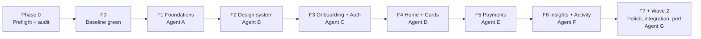

# FinPay UI and Motion Upgrade: Plan

Goal: bring FinPay to a polished, CRED NeoPOP-inspired fintech standard (dark, high-contrast, tactile 3D controls, physics-based motion, purposeful micro-interactions) while hardening the foundations underneath: integer money, a real dark theme, accessibility, security and test coverage.

## Waves and ownership

Wave 1 (C–F) runs sequentially: the build machine has 15 GiB of RAM (under the 16 GiB needed to run Gradle and test processes from several agents at once).

| Agent | Owns | Wave |
|---|---|---|
| Orchestrator | `main`, merges, progress tracking, final report | all |
| A. Foundations | `lib/core/`, `lib/models/`, `lib/data/`, `lib/domain/`, DI, routing, money migration | 0 |
| B. Design System | `lib/design_system/` (tokens, theme, typography, NeoPOP components, motion primitives), `/gallery` | 0 |
| C. Onboarding + Auth | `lib/screens/onboarding/`, `lib/screens/auth/` | 1 |
| D. Home + Cards | `lib/screens/home/`, `lib/screens/cards/` | 1 |
| E. Payments | `lib/screens/transfer/` | 1 |
| F. Insights + Activity | `lib/screens/statistics/`, `transactions/`, `notifications/`, `profile/` | 1 |
| G. QA + Perf | `integration_test/`, `test_driver/`, golden baselines, README | 2 |

## Branching
Each agent works in a git worktree `../wt-<agent>` on branch `ui/<agent>`. The orchestrator merges each finished feature into `main` with `git merge --no-ff`, runs the full check suite and pushes `origin main`. No force pushes, no history rewrites.

## Per-feature quality loop
1. Tests first (RED), minimum code (GREEN), refactor.
2. Unit tests (BLoCs, use cases, repositories, validators, money, migrations, animation state logic).
3. Widget tests for loading/empty/error/content, reduce-motion and haptics. Golden tests at 1.0× and 1.3× text scale.
4. Security pass → `docs/SECURITY_REVIEW.md`.
5. Load/performance simulation (`test/stress/`, tag `stress`) → `docs/LOAD_TEST_REPORT.md`.
6. Gate: `dart format`, `flutter analyze` (0 issues), `flutter test`, `flutter build apk --debug`.
7. Commit (Conventional Commits), merge, push.

## Feature list
- **F0** Baseline: format, analyzer to zero, tests green.
- **F1** Foundations: int paise money + DB migration, `Clock`, go_router with auth redirect, salted credential hash in secure storage, real dark theme, text scaling.
- **F2** Design system: tokens, NeoPOP components, motion primitives, widget gallery.
- **F3** Onboarding + Auth: parallax onboarding, NeoPOP forms, OTP, biometric setup.
- **F4** Home + Cards: collapsing balance header, odometer, card stack with flip/tilt/sheen, add-card live preview.
- **F5** Payments: keypad with rolling digits, swipe-to-pay, success/failure animations.
- **F6** Insights + Activity: animated charts, grouped transactions, notifications, profile settings.
- **F7** App-wide polish: transitions, splash, app icon, token compliance.
- **Wave 2**: integration flows, golden baselines, on-device performance traces, README, final report.

See `docs/UI_AUDIT.md` for the current-state audit and `docs/DECISIONS.md` for every judgement call.
